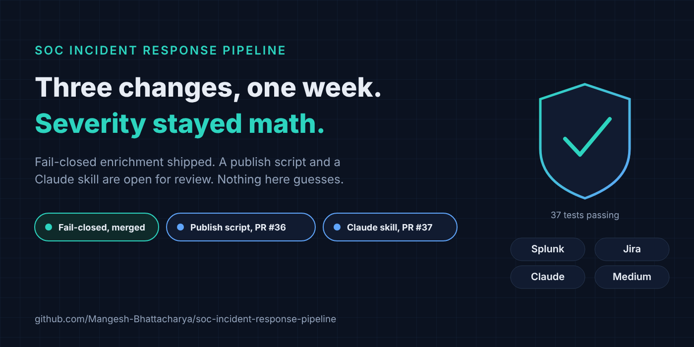
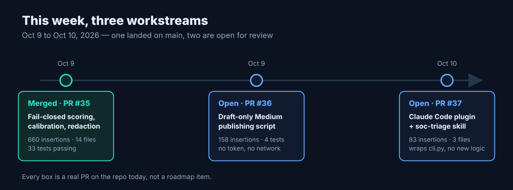
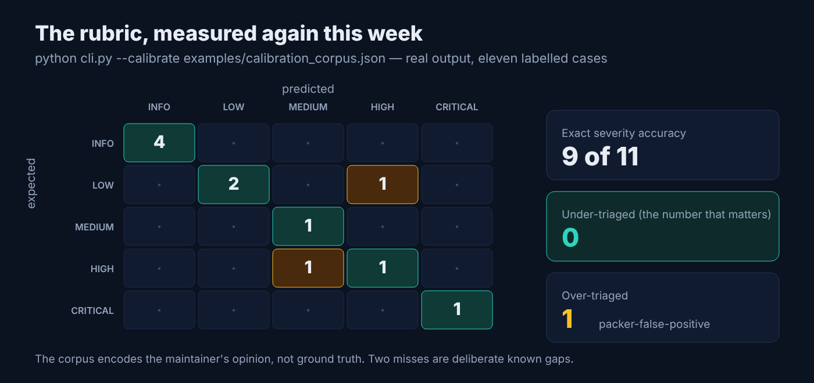
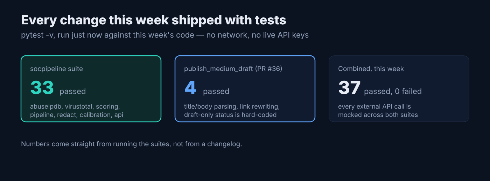

# This Week in soc-incident-response-pipeline: Fail-Closed Scoring, a Publish Script, and a Claude Skill

*Draft for Medium. Companion metadata, image prompts, and comment replies: [`2026-10-11-soc-incident-response-pipeline.meta.md`](2026-10-11-soc-incident-response-pipeline.meta.md).*



## TL;DR

In the span of two days this deterministic SOC triage pipeline went through three changes: a fail-closed fix that keeps a VirusTotal rate limit from silently dropping alerts (merged), a script that drafts this project's own Medium posts without ever hitting "publish" for you (still open for review), and a package that lets Claude run the same scorer from inside a chat session (merged). None of it touches the one rule the project is built around: severity is still arithmetic, not a model guess. Repo: [soc-incident-response-pipeline](https://github.com/Mangesh-Bhattacharya/soc-incident-response-pipeline).

*Update, Oct 16: [PR #37](https://github.com/Mangesh-Bhattacharya/soc-incident-response-pipeline/pull/37) merged after this post was drafted. [PR #36](https://github.com/Mangesh-Bhattacharya/soc-incident-response-pipeline/pull/36) is still open and has grown well beyond the publishing script described below — it now also adds a cross-platform launcher, a documentation-only support bot, and collaboration docs, and remains a draft. The specific insertion/test counts for #36 further down reflect its scope at the time of writing, not its current size.*

## What it is

[soc-incident-response-pipeline](https://github.com/Mangesh-Bhattacharya/soc-incident-response-pipeline) automates the first ten minutes of SOC alert triage: Splunk detects, VirusTotal and AbuseIPDB enrich, a transparent 0-100 rubric scores, and only alerts that clear the bar get a Jira ticket with the evidence already attached. It ships three interchangeable ways to run the same logic (a Python package and CLI, an importable n8n workflow, and a FastAPI backend behind a React dashboard), all installable with one `docker compose up`.

This week added three things on top of that:

- Enrichment lookups that fail (rate limit, timeout, missing key) now force a ticket instead of scoring as clean, closing a quota-exhaustion blind spot. Merged.
- A calibration harness (`cli.py --calibrate`) that scores a labelled alert corpus and reports under-triaged and over-triaged counts. Merged.
- An allowlist-based redaction tool (`cli.py --redact`) that pseudonymises users, hosts, and private IPs with a salted HMAC before an alert leaves the building. Merged.
- A draft-only script that turns a post in `docs/blogs/` into a Medium draft, never a published post. Open in [PR #36](https://github.com/Mangesh-Bhattacharya/soc-incident-response-pipeline/pull/36).
- A Claude Code plugin and `soc-triage` skill that wraps `cli.py` so you can paste an alert into a Claude chat and get the same deterministic verdict back. Merged in [PR #37](https://github.com/Mangesh-Bhattacharya/soc-incident-response-pipeline/pull/37).

## Why it matters

The project's one hard rule is that severity is arithmetic you can read in one file, not a model's opinion, because alert payloads contain attacker-controlled strings and routing them into a model that decides escalation hands the attacker a vote on whether anyone looks at the event. Everything shipped this week extends that rule instead of bending it.

The fail-closed fix matters because the old failure mode was invisible: a burst of correlated alerts exhausting the VirusTotal free tier used to turn every later alert into a clean `0/INFO` verdict, which looks identical to a genuinely benign alert in a dashboard. Now it is ticketed at Medium or higher and named in the reason line, which trades silent loss for a flooded queue, a trade the README is explicit about.

The other two changes matter for a different reason: they are about distribution and accessibility, not detection, and they are worth being honest about the boundary each one keeps. The publishing script hard-codes `publishStatus: "draft"` in the request body, not as a config default, so there is no flag that turns it into an auto-publisher. The Claude skill is scoped the same way: its own instructions tell Claude not to override or second-guess the score with a judgment call, and to treat a wrong-looking number as a reason to add the case to the calibration corpus, not to talk the user out of it. A tool that makes a deterministic system easier to reach is only safe if it cannot quietly make the system non-deterministic, and both of these were built to fail on the side of a human still being in the loop.

## Install

Prerequisites: Docker, or Python 3.10+.

**Docker (one command)**

```bash
git clone https://github.com/Mangesh-Bhattacharya/soc-incident-response-pipeline.git
cd soc-incident-response-pipeline
cp .env.example .env     # add API keys, or leave blank for demo mode
docker compose up --build
```

Open `http://localhost:8080`.

**Native**

```bash
python -m venv venv && source venv/bin/activate
pip install -r requirements-dev.txt
python cli.py --alert examples/sample_splunk_alert.json --dry-run
pytest tests/ -v          # 33 passed
```

Real output from that `--dry-run`, with no API keys configured:

```
Rule:      Suspicious Outbound Connection Following Malicious File Write
Host/User: WKS-FIN-0231 / j.alvarez
Score:     0/100  (INFO)
  - Enrichment incomplete, score reflects partial evidence and needs analyst review: VirusTotal: VT_API_KEY not configured; AbuseIPDB: ABUSEIPDB_API_KEY not configured
  ! Enrichment incomplete: treat the score as a lower bound, not a clean verdict
[dry-run] Would create Jira ticket: [INFO, ENRICHMENT FAILED] Suspicious Outbound Connection Following Malicious File Write — WKS-FIN-0231
```

**The publishing script (PR #36, not yet merged)**, run against this project's own previous post:

```bash
python scripts/publish_medium_draft.py docs/blogs/2026-10-09-soc-incident-response-pipeline.md --dry-run
```

```
TITLE: Your SOC Pipeline Should Fail Closed: Enrichment, Scoring, and Tickets You Can Audit
TAGS: ['cybersecurity', 'soc', 'automation']
```

followed by the post body with relative repo links already rewritten to full GitHub URLs. With `MEDIUM_TOKEN` set it does the same thing against the real Medium API, but still only ever creates a draft.

## How it works

```
Splunk alert --> normalize --> VirusTotal (hash) --> AbuseIPDB (IP) --> score_alert --> ticket?
                                                                            |
                                              enrichment_errors --> force ticket, priority >= Medium
```



### This week's three PRs

| PR | What | Status | Size |
|---|---|---|---|
| [#35](https://github.com/Mangesh-Bhattacharya/soc-incident-response-pipeline/pull/35) Fail-closed enrichment, calibration harness, alert redaction | Enrichment errors now force a ticket; `--calibrate` scores a labelled corpus; `--redact` pseudonymises alerts for sharing | Merged | 660 insertions, 14 files |
| [#36](https://github.com/Mangesh-Bhattacharya/soc-incident-response-pipeline/pull/36) Draft-only Medium publishing script | Reads `MEDIUM_TOKEN` from the environment only, hard-codes `publishStatus: draft`, rewrites relative links to GitHub URLs | Open (draft; size at time of writing — see note above) | 158 insertions, 4 tests |
| [#37](https://github.com/Mangesh-Bhattacharya/soc-incident-response-pipeline/pull/37) Claude Code plugin + `soc-triage` skill | Wraps `cli.py` as a Claude skill: triage an alert, run calibration, redact, with no logic reimplemented | Merged | 83 insertions, 3 files |

The interesting line from the merged fix, in [`scoring.py`](https://github.com/Mangesh-Bhattacharya/soc-incident-response-pipeline/blob/main/src/socpipeline/scoring.py):

```python
@property
def should_create_ticket(self) -> bool:
    return self.score >= TICKET_THRESHOLD_SCORE or self.enrichment_failed
```

The enrichment clients already separated "not found" from "lookup failed"; the scorer just never read the distinction before this week.





## Known limitations

From the README, still true this week: the VirusTotal term saturates at ten engines (`min(malicious * 6, 60)`), scoring uses absolute detection counts rather than ratios, there is no behavioural axis (forty failed logins scores the same as one), there is no enrichment caching or backoff so the fail-closed fix can flood the queue during a real outage, and the n8n webhook accepts unauthenticated POSTs by default unless you put it behind a shared secret.

Specific to this week's items: PR #37 is merged, so the Claude skill above is live on `main` — it is a thin wrapper, adds no detection logic of its own, and inherits every limitation above unchanged. PR #36 is still open and in draft; treat it as proposed, not shipped. The publishing script it carries does not upload images, and Medium's API for new integration tokens is no longer issued to new applications so it may be unusable for your account.

## Contributing

Repo: [soc-incident-response-pipeline](https://github.com/Mangesh-Bhattacharya/soc-incident-response-pipeline). PR #36 above is a real, reviewable diff, not a roadmap, so reading it and leaving a comment is a legitimate first contribution. Past that, the single most valuable thing this project can receive is a real labelled corpus: the bundled calibration set is eleven synthetic cases the maintainer wrote, and `python cli.py --calibrate <your-corpus>.json` works against anything shaped like it.

---

Repo: https://github.com/Mangesh-Bhattacharya/soc-incident-response-pipeline · Issues and PRs welcome.
