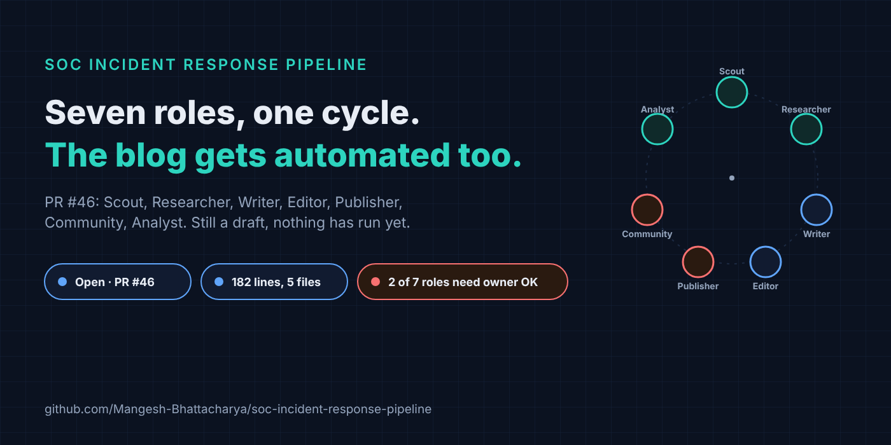
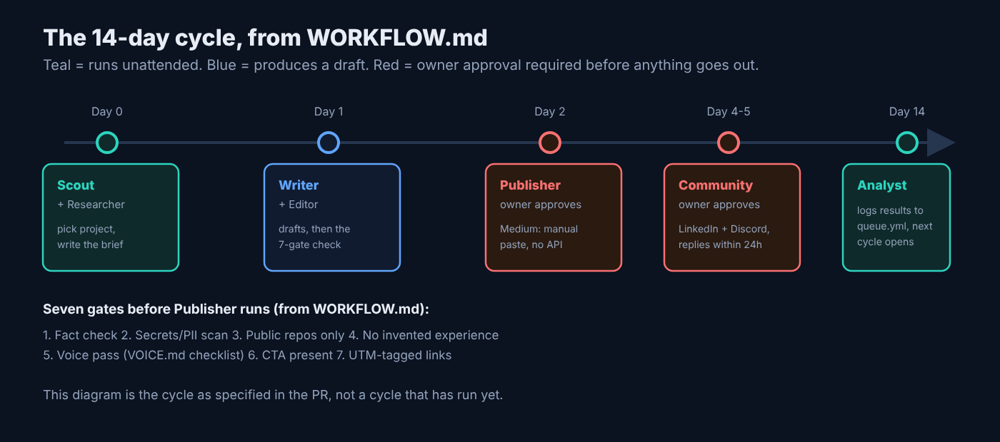
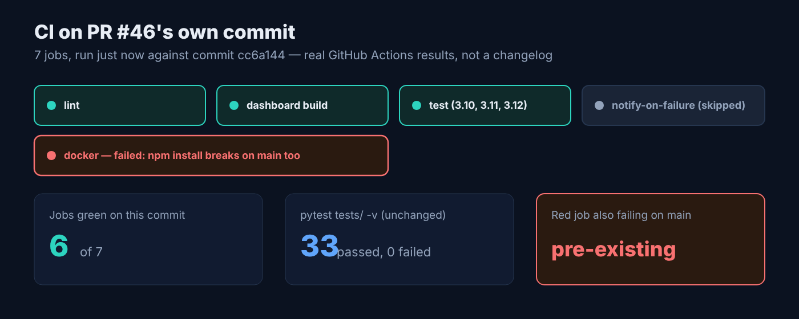
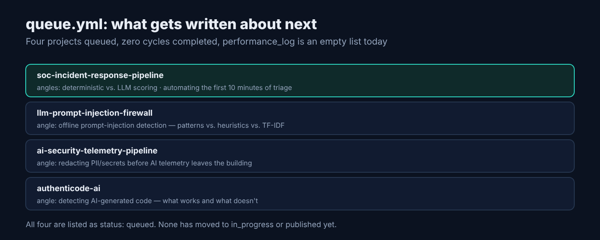

# This Week in soc-incident-response-pipeline: Turning the Weekly Blog Into a Seven-Agent Workflow

*Draft for Medium. Companion metadata: [`2026-10-18-soc-incident-response-pipeline.meta.md`](2026-10-18-soc-incident-response-pipeline.meta.md).*



## TL;DR

Five of the last six posts in this series got written the same ad-hoc way: open a terminal, read the last week of commits, draft something, hope the voice still matches last time. This week's change, open in [PR #46](https://github.com/Mangesh-Bhattacharya/soc-incident-response-pipeline/pull/46), replaces that with a defined seven-role cycle — Scout, Researcher, Writer, Editor, Publisher, Community, Analyst — plus a GitHub Action that opens a tracking issue every other Monday so the cycle has a trigger that outlives any one chat session. It is 182 lines across five files, still a draft opened yesterday, and nothing has run through it for real yet. Repo: [soc-incident-response-pipeline](https://github.com/Mangesh-Bhattacharya/soc-incident-response-pipeline).

## What it is

- The core pipeline is untouched this week: Splunk detects, VirusTotal and AbuseIPDB enrich, a deterministic rubric scores, Jira tickets what clears the bar. `pytest tests/ -v` still passes 33 of 33, same as last week, because nothing in `src/` changed.
- The addition is a new `blog-agent/` directory: `WORKFLOW.md` (seven roles, a 14-day cycle, seven publish gates), `VOICE.md` (a banned-phrase list and a humanization checklist an editor has to check off), `brief-template.md` (the fact sheet a researcher hands to a writer), and `queue.yml` (a backlog of four candidate repos with angle ideas and an empty `performance_log`).
- `.github/workflows/blog-cycle.yml` opens a GitHub issue every other Monday with a checklist of the cycle's steps, so the recurring trigger lives in the repo instead of in whichever chat session last remembered to run it. It also supports `workflow_dispatch` for a manual run.
- It is a draft, opened 2026-10-17, one commit, 182 additions across 5 files. No code changed — no scorer, no API route, no test.

## Why it matters

The project's whole premise is that the parts of SOC triage that can be made deterministic should be, and the parts that need a human judgment call should stay gated behind one. `blog-agent/WORKFLOW.md` applies the same split to writing about the project: Scout, Researcher, and Analyst can run without a human in the loop, but Publisher and Community are marked **owner approval required** in the role table, twice, in case the first mention wasn't enough. Nothing in this PR posts to Medium, posts to LinkedIn, or replies to a comment on its own. That matters more here than in the scoring code, because the failure mode of an unattended publisher isn't a missed alert, it's a post or a reply that goes out in the maintainer's name without him having read it.

The other reason this matters is a problem the previous five posts actually had, and `WORKFLOW.md` says so directly in a section literally titled "why previous posts brought no leads": they were tool-first instead of problem-first, and nothing enforced a consistent voice, a stated limitation, or a clear "here's how to hire me" line across posts. `VOICE.md`'s checklist — three repo-specific details, one admitted tradeoff, no banned filler, a specific comment-bait question before the hire-me line — is that enforcement, written down instead of re-derived from scratch each week. It's worth being honest about the obvious irony: this post, the one you're reading, was still written in the old ad-hoc way, by one agent reading recent commits and PRs in a single pass, because PR #46 hasn't merged and nothing has run through the new cycle yet. If it merges, next cycle's post is the one that should look different.

## Install

The project itself still installs the way it always has:

```bash
git clone https://github.com/Mangesh-Bhattacharya/soc-incident-response-pipeline.git
cd soc-incident-response-pipeline
cp .env.example .env     # add API keys, or leave blank for demo mode
docker compose up --build
```

The new piece doesn't install; it's markdown and a workflow file, read by whoever (human or agent) runs a cycle:

```bash
cat blog-agent/WORKFLOW.md   # roles, 14-day cycle, 7 gates
cat blog-agent/queue.yml     # the current backlog
```

`blog-cycle.yml` fires on a cron (`17 13 * * 1`, Mondays at 13:17 UTC) but only opens an issue on even ISO weeks — the odd ones log a skip message and exit. It can also be run on demand from the Actions tab via `workflow_dispatch`. I didn't trigger it for this post; the first real scheduled firing, whenever the week parity lands right, is the actual test of that math.

## How it works

The real logic worth reading is the parity check that decides whether a given Monday opens a cycle, from [`.github/workflows/blog-cycle.yml`](https://github.com/Mangesh-Bhattacharya/soc-incident-response-pipeline/blob/claude/intelligent-hopper-qipw9c/.github/workflows/blog-cycle.yml):

```js
const week = Math.ceil(((now - start) / 86400000 + 1) / 7);
if (context.eventName === 'schedule' && week % 2 !== 0) {
  core.info(`Week ${week} is off-cycle, skipping.`);
  return;
}
```



### This week's PR

| PR | What | Status | Size |
|---|---|---|---|
| [#46](https://github.com/Mangesh-Bhattacharya/soc-incident-response-pipeline/pull/46) Add GitHub-projects blogger agent workflow | `blog-agent/` (workflow, voice guide, brief template, queue) + `.github/workflows/blog-cycle.yml` | Open (draft) | 182 insertions, 5 files, 1 commit |

CI on that PR's own commit ran seven jobs: lint, three Python test matrices (3.10, 3.11, 3.12), and `dashboard` all passed; `notify-on-scheduled-failure` correctly skipped since nothing failed on a schedule run; `docker` failed. That failure isn't this change — the same `docker` job fails identically on `main` at the exact commit this PR branched from, because the dashboard image's `npm install` breaks on a Rolldown native-binding issue unrelated to any file this PR touches. It's a real, currently-unfixed gap in the repo, logged as a comment on the PR rather than quietly ignored or patched over inside a blog-agent PR that has no business touching the Dockerfile.



`queue.yml` lists four candidate repos for future cycles, each with its own angle ideas and a `performance_log` that is currently an empty list — nothing has been published through this workflow yet to log.



## Known limitations

From the README, still true and untouched this week: VirusTotal scoring saturates at ten engines, there's no behavioral axis, no enrichment caching, and the n8n webhook accepts unauthenticated POSTs by default without a shared secret in front of it.

Specific to this week's addition: PR #46 is a draft, unmerged, and nothing in it has executed outside of CI — no cycle has opened, no brief has been written, no post has gone through its gates. The publishing paths it names for LinkedIn and Discord (`LinkedInCLIAPI`, `DiscordCLIAPI`, both Zapier) aren't configured or implemented anywhere in this repo; they're referenced in `WORKFLOW.md` as the intended path, not working integrations. Medium gets no API path at all in this plan, same as every prior post here — manual paste or import is the only option, because Medium stopped issuing new integration tokens. The gates in `VOICE.md` and `WORKFLOW.md` are conventions a human or an agent has to actually apply; nothing in the repo lints a draft against them automatically. And the ISO-week-parity logic above has exactly zero production runs behind it as of this post.

## Contributing

Repo: [soc-incident-response-pipeline](https://github.com/Mangesh-Bhattacharya/soc-incident-response-pipeline). [PR #46](https://github.com/Mangesh-Bhattacharya/soc-incident-response-pipeline/pull/46) is a real, reviewable diff, not a roadmap — reading `WORKFLOW.md` and `VOICE.md` and leaving a comment on anything that looks wrong or missing is a legitimate first contribution. Past that, the most useful next step is running one real cycle end to end and writing an actual entry into `queue.yml`'s `performance_log`, which today has never recorded a single result.

---

Repo: https://github.com/Mangesh-Bhattacharya/soc-incident-response-pipeline · Issues and PRs welcome.
