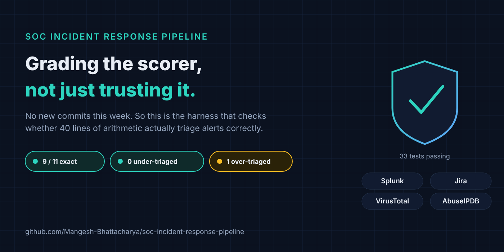
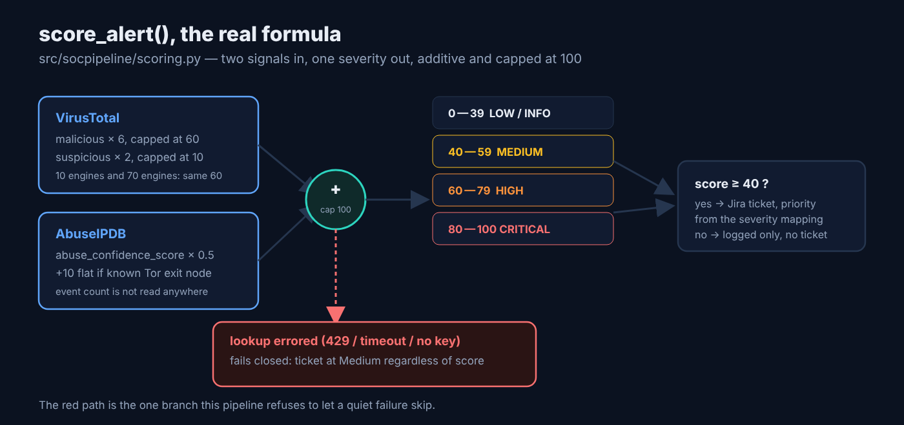
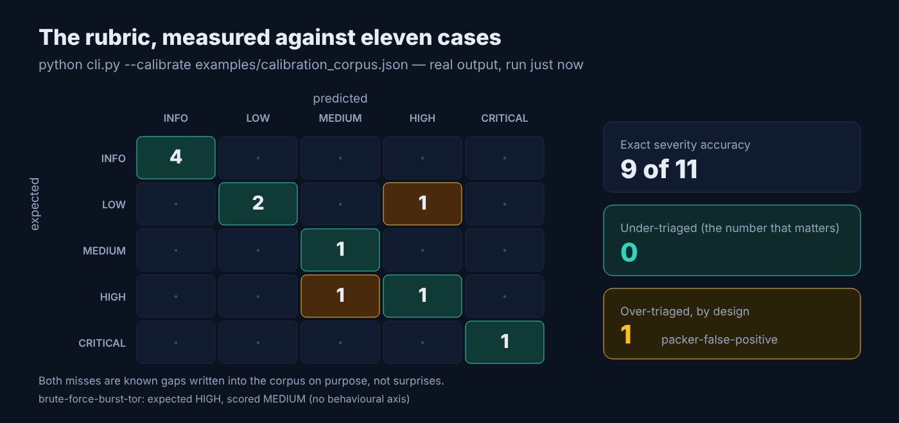
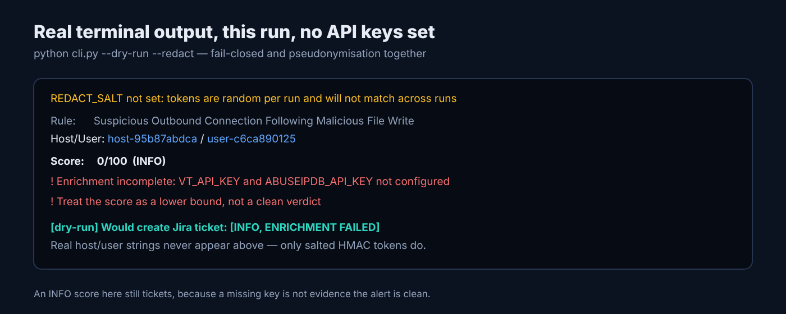

# Grading the Scorer: How I Check a Deterministic SOC Rubric Isn't Quietly Wrong

*Draft for Medium. Companion metadata, image captions, distribution plan, and comment replies: [`2026-11-08-soc-incident-response-pipeline.meta.md`](2026-11-08-soc-incident-response-pipeline.meta.md). Graphics are in [`images/`](images/).*



## TL;DR

Ten of seventy VirusTotal engines flagging a file hash and ten of twelve flagging it score the exact same 60 points in [soc-incident-response-pipeline](https://github.com/Mangesh-Bhattacharya/soc-incident-response-pipeline)'s rubric, a near-coin-flip detection and a near-unanimous one treated identically. Nothing substantive landed on the repo in the last seven days beyond dependency bumps, so instead of forcing a weekly update I'm going deep on the part of the project that actually tells you whether any of that arithmetic can be trusted: a calibration harness that scores eleven labelled alerts and reports exactly where the rubric is wrong. It currently gets 9 of 11 exactly right, zero under-triaged, and one over-triaged on purpose.

## What it is

- Automates a SOC analyst's first ten minutes on an alert: Splunk detects, VirusTotal and AbuseIPDB enrich, a transparent 0-100 rubric scores, and anything at 40 or above gets a Jira ticket with the evidence attached.
- Ships three interchangeable ways to run the same logic — a Python package and CLI, an importable n8n workflow, and a FastAPI backend behind a React dashboard — all installable with one `docker compose up`.
- Scores severity with roughly forty lines of readable arithmetic instead of a model, on purpose: the reasoning is in [`README.md`](https://github.com/Mangesh-Bhattacharya/soc-incident-response-pipeline#why-the-scoring-layer-is-deterministic) and comes down to reproducibility, auditability, and not handing an attacker-controlled string a vote on whether anyone looks at it.
- Includes a calibration harness (`cli.py --calibrate`) and a redaction tool (`cli.py --redact`) as first-class commands, not afterthoughts bolted on later.

## Why it matters

A rubric you can read in one file is only trustworthy if you've actually checked what it does on real cases, and "I read the code and it looks right" is not a check. The calibration harness in [`calibration.py`](https://github.com/Mangesh-Bhattacharya/soc-incident-response-pipeline/blob/main/src/socpipeline/calibration.py) turns that into a number: it runs the scorer against a corpus of labelled alerts and reports a confusion matrix plus two counts that matter more than raw accuracy — **under-triaged** (should have reached an analyst, didn't) and **over-triaged** (shouldn't have, did). Under-triage is the dangerous direction; it's a miss nobody notices until the incident review.

Right now the bundled corpus is eleven synthetic cases the maintainer wrote, which is an admitted limitation, not a boast — the README calls it "opinion rather than ground truth," and a real labelled corpus tops the contributing list. But even eleven synthetic cases force two real gaps into the open, deliberately: a VirusTotal term that saturates at ten engines, and a complete absence of any behavioural signal. Those gaps are documented in the test corpus itself, not just the README, which is the part I find more convincing than the 9/11 on its own.

## Install

No Docker needed for this path:

```bash
pip install -r requirements-dev.txt
cp .env.example .env   # fill in VT_API_KEY, ABUSEIPDB_API_KEY, JIRA_*, or leave blank for --dry-run

python cli.py --calibrate examples/calibration_corpus.json
```

The calibration command needs no API keys at all — the corpus embeds its own VirusTotal and AbuseIPDB results, so `evaluate()` calls `score_alert()` directly against fixture data. Run the test suite the same way, fully mocked:

```bash
pytest tests/ -v
```

Both commands are listed in `python cli.py --help`, which also documents `--redact` (pseudonymise before sharing) and `--dry-run` (skip Jira ticket creation) — I checked the flags against `--help` output rather than guessing.

## How it works

The scorer is additive and capped at 100: VirusTotal contributes up to 60 points from `malicious * 6` and up to 10 from `suspicious * 2`; AbuseIPDB contributes its abuse-confidence score weighted 50%, plus a flat 10 if the address is a known Tor exit node. Four severity bands map to a ticket decision at the 40-point line, and a separate fail-closed check overrides all of it: if either lookup errored rather than returning a clean result, the alert tickets at Medium regardless of score.



Running the calibration command for real, right now, against the bundled corpus:

```
Confusion matrix (rows = expected, columns = predicted)

              INFO      LOW   MEDIUM     HIGH CRITICAL
INFO             4        0        0        0        0
LOW              0        2        0        1        0
MEDIUM           0        0        1        0        0
HIGH             0        0        1        1        0
CRITICAL         0        0        0        0        1

Exact severity accuracy: 9/11 (82%)
Under-triaged (should ticket, did not): 0  []
Over-triaged  (should not ticket, did): 1  ['packer-false-positive']

Misclassified:
  brute-force-burst-tor: expected HIGH, got MEDIUM
  packer-false-positive: expected LOW, got HIGH
```



Both misses trace to named gaps, not bugs. `brute-force-burst-tor` is forty failed logins from a Tor exit node, labelled HIGH by the maintainer because a burst of that size against a dirty address should probably escalate harder than one failed login would — but the scorer discards event count entirely, so it scores identically to a single failed login from the same address and lands at 54 (MEDIUM). `packer-false-positive` is the mirror case: ten of seventy engines flag a hash, which is a plausible benign-packer false positive at that ratio, but `min(malicious * 6, 60)` treats ten detections the same as seventy, so it saturates to 60 points and tickets as HIGH.

The fail-closed path from the flow diagram above is also real output, not a hypothetical — here's what the CLI actually prints with no API keys configured, pseudonymised through `--redact` the same way you'd want to before pasting a real alert into a bug report:

```
REDACT_SALT not set: tokens are random per run and will not match across runs
Rule:      Suspicious Outbound Connection Following Malicious File Write
Host/User: host-95b87abdca / user-c6ca890125
Score:     0/100  (INFO)
  - Enrichment incomplete, score reflects partial evidence and needs analyst review
  ! Enrichment incomplete: treat the score as a lower bound, not a clean verdict
[dry-run] Would create Jira ticket: [INFO, ENRICHMENT FAILED]
```



A 0/100 score normally means "log only, no ticket." Here it tickets anyway, at Medium, because `enrichment_errors` is non-empty — the scorer distinguishes "no evidence of harm" from "no evidence at all," and treats the second case as something a human has to see.

## Known limitations

Straight from the README, still true today: the VirusTotal term saturates at ten engines regardless of how many actually fire; scoring uses absolute detection counts rather than ratios, even though `total_engines()` is already computed on the result object; there's no behavioural axis, which is the specific reason `brute-force-burst-tor` lands at MEDIUM instead of HIGH above; there's no enrichment caching or backoff, so a correlated alert burst can exhaust the VirusTotal free tier and fail-closed turns that into a flooded queue rather than silently dropped evidence; and the n8n webhook accepts unauthenticated POSTs by default unless you put it behind a shared secret. The corpus is eleven synthetic cases one person wrote, which is the honest ceiling on how much "9/11" should reassure anyone.

## Contributing

Repo: [soc-incident-response-pipeline](https://github.com/Mangesh-Bhattacharya/soc-incident-response-pipeline). The single most valuable contribution this project can take right now is a real labelled corpus — anonymised alerts with an analyst-assigned severity, shaped like the cases in [`examples/calibration_corpus.json`](https://github.com/Mangesh-Bhattacharya/soc-incident-response-pipeline/blob/main/examples/calibration_corpus.json). `python cli.py --calibrate <your-corpus>.json` works against anything in that shape, and `evaluate()` in `calibration.py` accepts any scorer matching `score_alert`'s signature, so it also doubles as the harness for comparing a model-based scorer against this one on identical inputs, if that's a comparison you want to run.

---

Repo: https://github.com/Mangesh-Bhattacharya/soc-incident-response-pipeline · Issues and PRs welcome.
