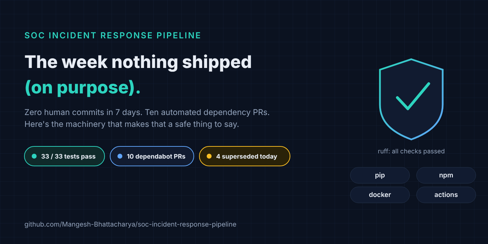
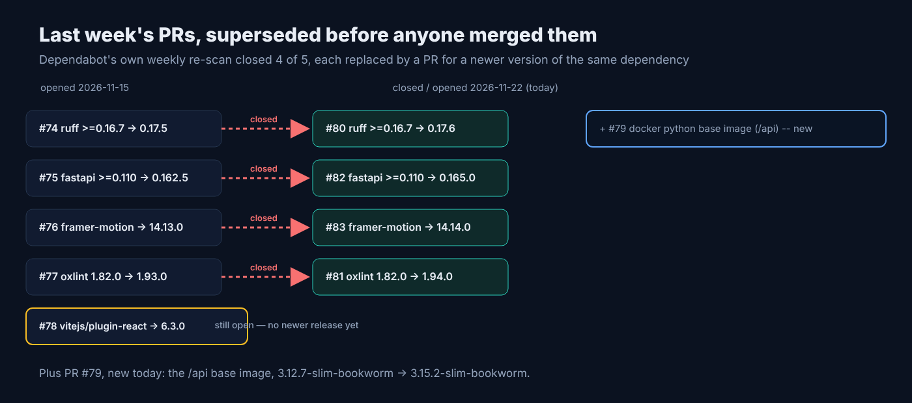
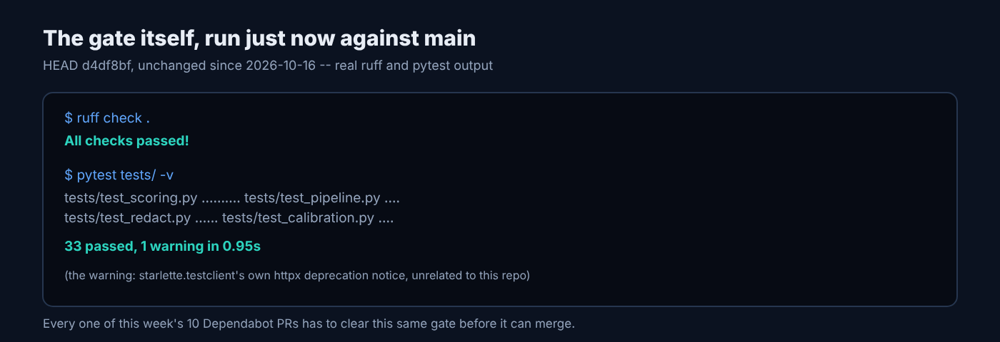
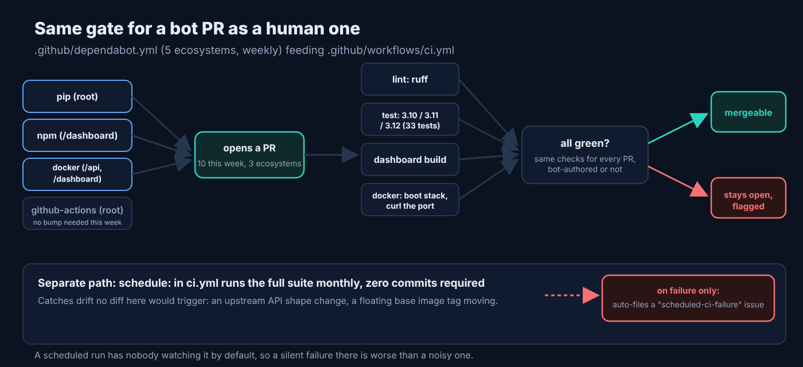

# The Week Nothing Shipped: What a Dependency-Update Pipeline Actually Does When It Works

*Draft for Medium. Companion metadata: [`2026-11-22-soc-incident-response-pipeline.meta.md`](2026-11-22-soc-incident-response-pipeline.meta.md). Social copy: [`2026-11-22-soc-incident-response-pipeline-social.md`](2026-11-22-soc-incident-response-pipeline-social.md). Images: `docs/blogs/images/2026-11-22-*.png`.*



## TL;DR

No human touched [soc-incident-response-pipeline](https://github.com/Mangesh-Bhattacharya/soc-incident-response-pipeline)'s `main` branch in the last seven days. What did happen: Dependabot opened ten pull requests across three ecosystems, and four of the five it opened a week ago were closed today and replaced by a newer version of the same dependency before anyone merged them. That is not neglect, it is the update cadence working as designed, so instead of forcing a feature post this week I am looking at the machinery that makes "nothing shipped" a safe thing to say rather than a worrying one: Dependabot's five watch rules, the CI gate every one of its PRs has to clear, and the scheduled run that checks for drift even when nobody pushes anything at all.

## What it is

- Automates a SOC analyst's first ten minutes on an alert: Splunk detects, VirusTotal and AbuseIPDB enrich, a transparent 0-100 rubric scores it, and anything at 40 or above gets a Jira ticket with the evidence already attached.
- Ships three interchangeable ways to run the same logic — a Python package and CLI, an importable n8n workflow, and a FastAPI backend behind a React dashboard — all installable with one `docker compose up`.
- Scores severity with roughly forty lines of readable arithmetic instead of a model, specifically because alert fields are attacker-controlled strings and handing a model the escalation decision hands the attacker a vote on whether anyone looks at the event.
- Runs its own maintenance: Dependabot across pip, npm, and two Docker images, CodeQL on every push plus weekly on its own, and a monthly scheduled CI run that fires even with zero commits.

## Why it matters

A dependency bump is the least interesting kind of pull request to read and the easiest one to wave through unreviewed, which is exactly why it is worth checking whether the gate around it actually holds. This week is a clean natural experiment: ten PRs, zero of them opened by a person, and I can either trust that they are fine because they are "just" version bumps, or I can check what actually stood between one of them and `main`.

What stood between them is the same `ci.yml` that gates a human's PR: `ruff check .` for lint, the 33-test `pytest` suite across Python 3.10, 3.11, and 3.12, a job that validates the n8n workflow JSON still parses, a dashboard build and lint pass, and a Docker job that boots the real `docker compose` stack, waits for both containers to report healthy, and curls the published port. None of that is skipped for a Dependabot PR. A version bump that breaks the scoring rubric's import path or changes a FastAPI response shape fails the same way a human's regression would.

The more interesting detail is what happened to last week's batch. Dependabot opened five PRs on 2026-11-15: bumps for `ruff`, `fastapi`, `framer-motion`, `oxlint`, and `@vitejs/plugin-react`. By today, 2026-11-22, four of those five had been closed and replaced — `ruff` (#74 → #80), `fastapi` (#75 → #82), `framer-motion` (#76 → #83), and `oxlint` (#77 → #81) each got superseded by a fresh PR proposing a newer version of the exact same dependency, because a newer release landed before anyone merged the first one. Only the `@vitejs/plugin-react` PR (#78) is still open unchanged, simply because no newer release has shipped for it yet. Nobody manually closed and reopened those four PRs. Dependabot's own weekly re-scan did it, which means the real failure mode this setup is defending against is not "a bad version gets merged" so much as "a stale, already-superseded version gets merged because nobody looked at the PR for three weeks." A PR that quietly becomes outdated while waiting for review is a worse outcome than one that gets closed and replaced.



## Install

Running the exact gate Dependabot's PRs have to pass, from the README:

```bash
pip install -r requirements-dev.txt
ruff check .
pytest tests/ -v
```

Real output, run just now against current `main` (`d4df8bf`, unchanged since 2026-10-16):

```
$ ruff check .
All checks passed!

$ pytest tests/ -v
...
======================== 33 passed, 1 warning in 0.95s =========================
```

The one warning is `starlette.testclient`'s own deprecation notice about `httpx`, unrelated to anything in this repo's code.



## How it works

Dependabot's watch list, from [`.github/dependabot.yml`](https://github.com/Mangesh-Bhattacharya/soc-incident-response-pipeline/blob/main/.github/dependabot.yml), is five update blocks, each on a weekly schedule: `pip` at the repo root (which follows the `-r` includes across `requirements.txt`, `requirements-api.txt`, and `requirements-dev.txt` automatically), `npm` in `/dashboard`, `docker` in `/api` and separately in `/dashboard` for the two base images, and `github-actions` at the root for the workflow files themselves. This week's ten PRs touched three of those five: pip (`ruff`, `fastapi`), npm (`framer-motion`, `oxlint`, `@vitejs/plugin-react`), and docker (`python` base image in `/api`, PR #79, bumping `3.12.7-slim-bookworm` toward `3.15.2-slim-bookworm`). No GitHub Actions version needed a bump this week.

```
Dependabot (weekly, 5 ecosystems) --> opens PR --> ci.yml gate:
    lint (ruff)  -->  test (pytest x3 Python versions)  -->  dashboard build/lint  -->  docker (boots the real stack, curls it)
                                                                              |
                           all green --> mergeable           any red --> stays open, flagged
```



Separate from the push/PR path, `ci.yml` also carries a `schedule:` trigger that runs the full suite monthly with zero commits required, specifically to catch drift this repo's own diffs would never trigger a test for — an upstream API shape changing, or a floating base image tag moving underneath a pinned Dockerfile. A `notify-on-scheduled-failure` job runs only when that monthly cron run fails (`github.event_name == 'schedule'`), and auto-files a GitHub issue labeled `scheduled-ci-failure`, because unlike a failed PR check, nobody is watching a cron job by default.

## Known limitations

This section is honest about the scoring and enrichment layer elsewhere in the README (no behavioural axis, VirusTotal saturates at ten engines, no enrichment caching), and the maintenance machinery this post covers has its own, narrower limitation: Dependabot's `open-pull-requests-limit: 10` on the pip and npm blocks means a dependency that is bumped often enough, or a maintainer who reviews rarely enough, could in principle hit that cap and stop opening new PRs for that ecosystem until existing ones close. That has not happened here yet — this week's volume (five open PRs across npm and pip combined after today's batch) sits well under it — but it is a ceiling worth knowing is there rather than discovering during an actual gap. CodeQL's weekly self-scan and the monthly CI schedule both assume the repository stays public, since both are free only on GitHub's public-repo tier.

## Contributing

Repo: [soc-incident-response-pipeline](https://github.com/Mangesh-Bhattacharya/soc-incident-response-pipeline). The maintenance setup here is plain YAML and worth stealing wholesale for another project: `.github/dependabot.yml` for the five-ecosystem watch list and `.github/workflows/ci.yml` for the schedule trigger and the auto-filed issue on a silent scheduled failure. Past that, the README's own ranked contribution list still stands, led by a real labelled alert corpus to replace the eleven synthetic cases the calibration harness currently grades against — `python cli.py --calibrate <your-corpus>.json` works against anything shaped like the bundled example.

---

Repo: https://github.com/Mangesh-Bhattacharya/soc-incident-response-pipeline · Issues and PRs welcome.
